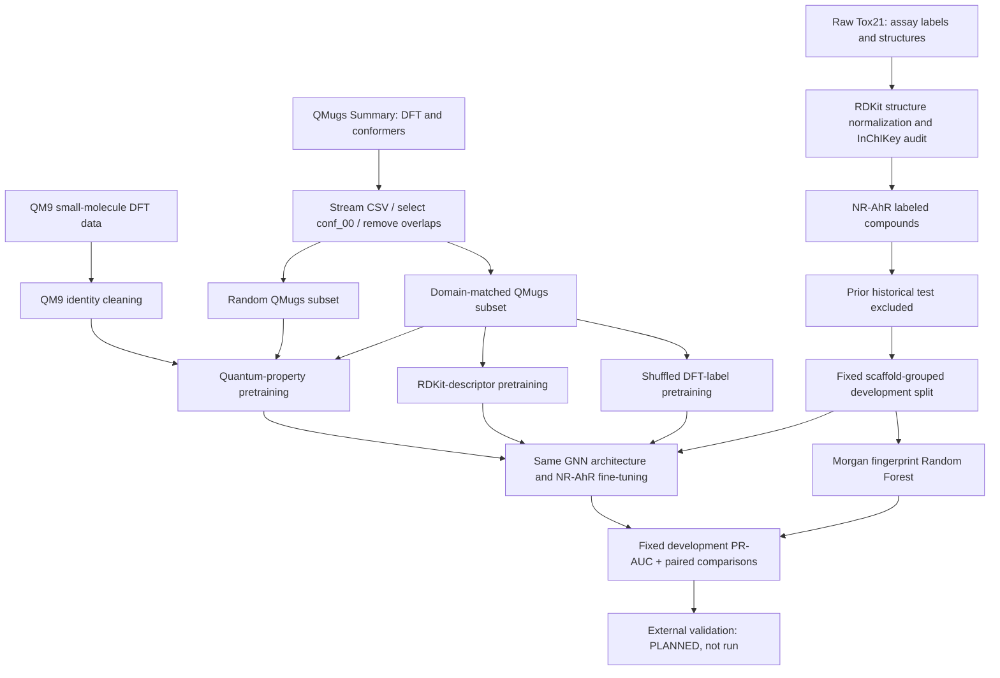

# QuantumBridge-Tox

> **GitHub repository name:** `QuantumBridge-Tox`  
> **GitHub description (copy/paste):** Domain-aware DFT pretraining for molecular GNNs: QM9/QMugs to Tox21 AhR, with RDKit baselines and shuffled-label controls.  
> **Create a repository:** https://github.com/new  
> **Suggested topics:** `molecular-gnn`, `quantum-chemistry`, `dft`, `qmugs`, `tox21`, `transfer-learning`, `chemoinformatics`, `pytorch`, `rdkit`, `explainable-ai`  
> **Suggested visibility:** Public (if you intend to showcase this research).  
> **Repository URL:** After creation, GitHub will show the exact URL. For the account `sanatat`, it would be `https://github.com/sanatat/QuantumBridge-Tox` *only after the repository is created*.

---

### Domain-aware quantum-property pretraining for molecular AhR bioactivity prediction

**Research pilot · CPU-first · Tox21 NR-AhR · Development evaluation only · Not externally validated**

QuantumBridge-Tox investigates whether a lightweight molecular graph neural network (GNN) can benefit from **pretraining on quantum-chemical properties** before learning to classify the **Tox21 NR-AhR assay**. Rather than assuming that any large quantum dataset is helpful, the project asks which molecules should be used for pretraining, whether physically meaningful electronic-property labels matter, and whether gains persist against standard molecular descriptors and strong classical baselines.

The project progressed from an initial QM9/Tox21 overlap audit to **QMugs-based domain-aware transfer learning**, matched-data DFT/RDKit controls, fixed-scaffold development evaluation, repeated training initializations, and **three independently shuffled quantum-label controls**.

> **Main finding (pilot, not a confirmatory claim):** On one fixed 942-compound scaffold-partitioned development evaluation, a GNN pretrained on domain-matched QMugs DFT labels attained **PR-AUC 0.3704 ± 0.0083** across five training seeds, compared with **0.3432 ± 0.0169** for the same GNN trained from scratch. The genuine DFT model exceeded shuffled-label controls in **14 of 15 correlated comparisons** across five training seeds and three label permutations. However, its improvement over a matched RDKit-descriptor pretraining control was small and inconsistent (**+0.0047 mean PR-AUC**); a Morgan-fingerprint **Random Forest remained strongest** (**PR-AUC 0.3981 ± 0.0047**). **No independent external validation has been completed.**

## At a glance

| Item | What was actually done |
|---|---|
| Toxicity target | **Tox21 NR-AhR**, binary assay-activity classification; **not** clinical toxicity or general cancer-risk prediction |
| Cleaned labeled subset | **6,440** unique, usable NR-AhR molecules; **763** positives; 3 conflicting InChIKeys excluded |
| Fixed development protocol | 3,609 train / 670 inner validation / **942 development evaluation** molecules (115 positives) |
| Historical test partition | 1,219 molecules excluded from v0.8–v0.9. **Previously evaluated during v0.3**, so not globally blind |
| Pretraining datasets | QM9 small-molecule quantum properties; **QMugs** large/drug-like molecular quantum properties |
| QMugs processing | **1,992,984 conformer rows scanned**; **32,023 unique eligible structures** in a deterministic 5%-sample pool |
| Neural architecture | Lightweight **2D molecular message-passing GNN**, implemented in **PyTorch without PyTorch Geometric**; CPU-only |
| Principal design | Domain-matched vs random QMugs molecule selection; real DFT vs RDKit vs shuffled DFT supervision |
| Primary metric | **PR-AUC (scikit-learn average precision)**; ROC-AUC, F1, MCC are secondary |
| Experimental status | Repeated development studies through **v0.9**; external AhR evaluation **not performed** |

## Key figures


> The figures summarize exploratory results from prior local runs; they are not newly computed by unpacking this ZIP. See [Archive contents and missing files](docs/ARCHIVE_CONTENTS.md).

## Research questions

1. Does quantum-property pretraining transfer to bioactivity classification better than training a molecular GNN from scratch?
2. Does choosing **chemically relevant pretraining molecules** help more than random selection from the same quantum dataset?
3. Does the improvement require a **real correspondence between molecular structure and DFT labels**, or is the pretraining procedure alone sufficient?
4. Is the effect **specific to DFT**, relative to inexpensive RDKit descriptor-prediction pretraining?
5. Can improvements approach or exceed a well-tuned, conventional **Morgan-fingerprint Random Forest**?

## Workflow



## Data and quality-control work

### 1. Tox21 assay labels

- Source: [DeepChem-hosted Tox21 CSV](https://deepchemdata.s3-us-west-1.amazonaws.com/datasets/tox21.csv.gz), with the [DeepChem Tox21 loading code](https://github.com/deepchem/deepchem/blob/master/deepchem/molnet/load_function/tox21_datasets.py) as a reference.
- Molecular identity was tracked by **InChIKey**; invalid/duplicate structures and conflicting labels were audited rather than silently assumed independent.
- The complete cleaned collection used in the chemical-domain audit had **7,706 unique chemical identities**. The NR-AhR modeling subset was **6,440 usable labeled identities** after task-specific filtering (763 positives, three conflicting keys removed). These are **different audit populations** and should not be conflated.
- Missing assay results were **not** converted to negative examples.
- Scaffold-aware splitting was used to reduce close-analog leakage. This does **not** guarantee novel-scaffold or external generalization.

### 2. Why QM9 alone was not sufficient

The initial chemical-domain audit compared QM9 with Tox21 using heavy-atom count, molecular weight, LogP, TPSA, aromaticity, and presence of Cl/Br/I. Defining a deliberately simple **QM9-like necessary-condition domain** as (i) no more than nine heavy atoms and (ii) atom types within C/H/N/O/F:

- **788 / 7,706 (10.23%)** cleaned Tox21 molecules met those criteria.
- **6,918 / 7,706 (89.77%)** were outside that domain.
- Of the initially audited, labeled NR-AhR compounds, only **38 positives among 732 QM9-like labeled molecules**, versus **726 positives among 5,708 outside-domain labeled molecules**. This domain audit used a slightly different duplicate/label-handling population from the final 6,440-molecule training subset; do not sum its positives and treat them as the model's final positive count.

| Descriptor (median) | QM9 sample (5,000) | Tox21 cleaned identities (7,706) | QMugs selected pool (32,023) |
|---|---:|---:|---:|
| Heavy atoms | 9 | 16 | 30 |
| Molecular weight | 125.13 | 237.94 | 417.55 |
| LogP | 0.28 | 2.37 | 3.77 |
| Aromatic rings | 0 | 1 | 3 |

**Interpretation:** QM9 and Tox21 occupy very different regions of chemical descriptor space. This establishes a distribution mismatch, **not** that it alone causes the difference in model accuracy. The QM9-like condition is an element/size screen, **not** proof of exact structural coverage by QM9.

An exploratory direct QM9–Tox21 identity-overlap pilot found **411 matches**, but the relevant NR-AhR positives were heavily concentrated in one scaffold; that direct overlap experiment was **not accepted as robust evidence of DFT benefit**. Subsequent modeling excluded QM9 molecules with duplicated/ambiguous keys and all Tox21 identities from the quantum pretraining set.

### 3. Streaming QMugs preparation

Source: [QMugs paper / dataset](https://www.nature.com/articles/s41597-022-01390-7) and the [QMugs Summary table](https://huggingface.co/datasets/JuIm/QMugs_Summary).

The ~2.03 GB Summary CSV was **read in chunks**, not loaded into ~7 GB of system RAM in full. The recorded preprocessing audit was:

| Processing stage | Count |
|---|---:|
| Conformer rows scanned | 1,992,984 |
| `conf_00` conformer rows | 664,303 |
| Deterministically selected by hash (~5%) | 33,000 |
| Excluded by calculation-quality filter | 865 |
| Excluded for Tox21 identity overlap | 93 |
| Excluded as repeated InChIKey | 19 |
| **Accepted unique structures** | **32,023** |

The selected 2D molecular graphs used **one `conf_00` conformer per molecule** for quantum-property labels. `conf_00` is **not guaranteed** to be its lowest-energy conformer. The models therefore map 2D connectivity to some **conformer-dependent** labels, an important limitation.

**Actual QMugs DFT pretraining targets:**

| Label used | Source column | Notes |
|---|---|---|
| Dipole magnitude `mu` | `DFT_DIPOLE_TOT` | Conformer-dependent |
| HOMO energy | `DFT_HOMO_ENERGY` | Electronic-property regression |
| LUMO energy | `DFT_LUMO_ENERGY` | Electronic-property regression |

The Summary also provides `GFN2_POLARIZABILITY_MOLECULAR`, but that is **GFN2-xTB**, **not a DFT polarizability label**. It was **not** included in the matched-QMugs DFT-vs-RDKit experiments. The QM9 and QMugs calculation methods and label distributions differ, so direct cross-dataset regression R² comparisons are not controlled comparisons.

## Modeling and experimental controls

### Lightweight message-passing GNN

- Graphs: atom/bond features derived with **RDKit** from SMILES.
- Implementation: pure **PyTorch**, small message-passing encoder (reported experiments used hidden dimension **32**); no PyTorch Geometric requirement.
- Pretraining: regression from molecular graphs to normalized QM9/QMugs electronic properties or to RDKit descriptors; track **MAE, RMSE, and R²** per property.
- Fine-tuning: binary classification of **NR-AhR**; choose the best checkpoint by inner-validation **average precision**, and select F1/MCC classification thresholds **only on the inner-validation fold**.
- Baseline: scikit-learn **RandomForestClassifier** on Morgan fingerprint features, scored on the same development identities.

**Principal v0.8/v0.9 controls:**

| Condition | Pretraining molecular identities | Supervision |
|---|---|---|
| Scratch GNN | None | NR-AhR training only |
| QMugs random DFT | Random QMugs subset | True dipole/HOMO/LUMO DFT labels |
| QMugs matched DFT | Domain-selected QMugs subset | True dipole/HOMO/LUMO DFT labels |
| QMugs random RDKit | Random QMugs subset | Molecular weight, TPSA, LogP, HBD |
| QMugs matched RDKit | **Exactly the same molecular identities as matched DFT** | Molecular weight, TPSA, LogP, HBD |
| QMugs matched shuffled DFT | **Exactly the same molecular identities as matched DFT** | Jointly permuted dipole/HOMO/LUMO label vectors |
| Random Forest | Labeled Tox21 training compounds | Morgan-fingerprint supervised baseline |

For **matched** selection, molecular-size/physicochemical descriptors were closer to Tox21 than for random QMugs sampling, although the selected fraction of Cl/Br/I-containing compounds was **less close**. Domain matching therefore improves several descriptors, **not every aspect of chemical coverage**.

### Fixed split, repeated training, and negative-control design

The final development comparison **v0.8** fixed the scaffold split (`--split-seed 42`), QMugs molecule selection (`--selection-seed 42`), and pretraining validation identity pool. Only training/initialization randomness was varied across **42, 123, 2026, 731, 1701**. Each condition used **5,000** pretraining molecules, up to **8 pretraining epochs**, **12 fine-tuning epochs**, hidden size **32**, and batch size **32**.

Version **v0.9** used the same split and model-training seeds while jointly shuffling the three DFT labels across the matched molecules. Jointly permuting the three-component targets preserves the **joint target distribution** but breaks the intended relationship between **specific molecular graphs** and their electronic properties. Separate shuffled mappings were also used for the pretraining-validation pool. Three permutations were tested: **918273, 271828, 314159**. Tox21 toxicity labels were **never shuffled**.

## Results

### Fixed-development model comparison (v0.8)

**Primary metric: PR-AUC / average precision.** Values are **mean ± sample SD across five initialization seeds** on the **same 942-molecule development evaluation**; they are **not** five independent external tests.

| Model | PR-AUC | ROC-AUC | F1 | MCC |
|---|---:|---:|---:|---:|
| **Random Forest (Morgan)** | **0.3981 ± 0.0047** | **0.8358** | **0.4246** | **0.3402** |
| QMugs **matched DFT** GNN | **0.3704 ± 0.0083** | 0.8265 | 0.4035 | 0.3235 |
| QMugs matched RDKit GNN | 0.3657 ± 0.0254 | 0.8266 | 0.3683 | 0.2940 |
| QMugs random DFT GNN | 0.3606 ± 0.0148 | 0.8215 | 0.3824 | 0.3041 |
| QMugs random RDKit GNN | 0.3542 ± 0.0204 | 0.8218 | 0.3649 | 0.2888 |
| Scratch GNN | 0.3432 ± 0.0169 | 0.8044 | 0.3309 | 0.2574 |

**Figure-free README:** the full numerical comparison is in the table above. This single file requires no separate figure assets.

**Paired mean PR-AUC differences, matched DFT minus comparator:**

| Comparator | Mean paired Δ PR-AUC | Positive seeds | Interpretation |
|---|---:|---:|---|
| Scratch GNN | **+0.0272** | 5/5 | Consistent within this fixed evaluation split |
| QMugs random DFT | +0.0098 | 4/5 | Suggestive benefit from molecular selection |
| QMugs matched RDKit | **+0.0047** | 3/5 | **No convincing quantum-specific superiority** |
| Random Forest | **−0.0277** | 0/5 | Classical baseline **still stronger in PR-AUC** |

Earlier v0.7 runs varied the scaffold development split along with training seeds. They suggested a larger DFT-vs-RDKit mean delta (**+0.0228**) but per-split scaffold-bootstrap intervals included zero. **v0.7 and v0.8 estimates should not be merged as if they shared the same protocol.**

### Shuffled-label negative controls (v0.9)

The genuine matched-DFT GNN obtained **mean PR-AUC 0.3704**. Three independent target-row permutations were run, each under the **same five training seeds**.

| Shuffled-target mapping seed | Mean real-DFT minus shuffled-DFT PR-AUC | Positive training-seed contrasts |
|---|---:|---:|
| `918273` | +0.0315 | 5/5 |
| `271828` | +0.0278 | 5/5 |
| `314159` | +0.0253 | 4/5 |
| **Average across mappings** | **+0.0282** | **14/15 correlated contrasts** |

**Per-training-seed paired mean PR-AUC deltas (averaged over three label permutations):**

| Training seed | Real DFT − mean shuffled DFT | Three shuffles with positive deltas |
|---|---:|---:|
| 42 | +0.0378 | 3/3 |
| 123 | +0.0097 | 3/3 |
| 731 | +0.0085 | 2/3 |
| 1701 | +0.0447 | 3/3 |
| 2026 | +0.0401 | 3/3 |

The corresponding **average shuffled-DFT PR-AUC was approximately 0.3422**. All five training seeds had a positive **average** genuine-minus-shuffled difference after averaging the three maps; seed `731` was negative for one permutation.

A descriptive, seed-aggregated **95% t interval** of approximately **[+0.006, +0.050]** was calculated over five per-training-seed mean deltas. It reflects a **single fixed development fold**, only three permutation maps, and post-exploratory analysis; it is **not a preregistered confirmatory confidence interval**. The 15 contrasts are correlated, since the same real-DFT models and evaluation compounds are reused.

The shuffled-label model produced negative or near-zero R² on the actual DFT labels (first permutation: mean HOMO **−0.0096**, LUMO **−0.1081**, dipole **−0.0746**), confirming that the negative-control models did not learn the intended graph-to-DFT mapping.

### What we achieved — and what we did not demonstrate

**Supported by the development experiments:**

- Built and ran an end-to-end **CPU-only** molecular GNN/quantum-pretraining pipeline, including careful identity cleaning and scaffold-aware evaluation.
- Quantified the **QM9–Tox21 chemical-domain mismatch** (only 10.23% QM9-like by simple element/size criteria).
- Stream-processed a large QMugs resource into an auditable 32,023-molecule, unique-identity pool; selected more target-relevant QMugs subsets without using the held-out evaluation identities for matching.
- Implemented **same-molecule DFT-vs-RDKit** and **real-vs-shuffled DFT** negative controls.
- Observed a **+0.0272 mean PR-AUC** matched-DFT benefit over a scratch GNN on a fixed development fold, and **+0.0282** relative to three shuffled-label controls averaged across model seeds and mappings.
- Identified key limits: **RDKit control nearly matches DFT**, and **Random Forest remains stronger** on the primary metric.

**Not supported and therefore not claimed:**

- That quantum-specific DFT descriptors outperform conventional RDKit descriptor pretraining in general.
- That the results establish general toxicity, human health risk, or clinical efficacy.
- That repeated model seeds are independent held-out datasets.
- That the older v0.3 held-out test is globally blind (it was viewed earlier).
- That a truly independent external AhR assay has already been evaluated.

## Reproduce the development experiments

**This repository archive includes the available project source code and documentation, but not the original local datasets, experiment outputs or historical split artifact.** To rerun the numerical experiments, the input datasets and historical split artifact are still required. The numerical results below were transcribed from completed local logs, not newly reproduced by merely opening this README. Raw QMugs (~2 GB), checkpoints and CSV run outputs are intentionally not embedded.

### Prerequisites

- Linux and **Python 3.12** (the reported workstation ran Linux Mint and CPU PyTorch).
- `numpy`, `pandas`, `scikit-learn`, `rdkit`, `scipy`, `torch`. Matplotlib is optional for charts.
- The project source files `quantumbridge.py`, `gnn_quantumbridge.py`, `gnn_quantumbridge_v05.py`, `gnn_quantumbridge_v07.py`, `gnn_quantumbridge_v08.py`, `gnn_quantumbridge_v09.py`, `extract_qmugs_v06.py`, `test_v08.py`, `test_v09.py` and the earlier study files.
- Raw **Tox21**, **QM9**, **QMugs Summary**, and `results/gnn_v03_5k/tox_split.csv` generated in the earlier protocol.

```bash
python3 -m venv .venv
source .venv/bin/activate
pip install -r requirements.txt
pip install torch scipy
python test_v08.py
python test_v09.py
```

For reproducibility, record `python --version`, `pip freeze`, script SHA-256 hashes, and input file checksums alongside the run manifests. Use a current CPU-compatible PyTorch build appropriate to your platform.

### Dataset paths

```text
data/
├── tox21_clean.csv.gz                # locally prepared from Tox21
├── qm9.csv                           # externally downloaded QM9 CSV
└── qmugs/
    ├── summary.csv                   # raw ~2.03 GB table; NOT for Git
    ├── qmugs_v06_pool.csv.gz         # cleaned deterministic QMugs sample
    └── qmugs_v06_audit.json

results/
└── gnn_v03_5k/
    └── tox_split.csv                 # historical test partition, needed for v0.8
```

The raw QMugs Summary can be obtained from the dataset source linked above. For the clean local QMugs pool (after `data/tox21_clean.csv.gz` is prepared):

```bash
python -u extract_qmugs_v06.py \
  --source data/qmugs/summary.csv \
  --sample-rate 0.05 --chunksize 20000 \
  --out data/qmugs/qmugs_v06_pool.csv.gz \
  --audit-out data/qmugs/qmugs_v06_audit.json
```

The extraction script **refuses to overwrite** existing outputs. It may take time on a CPU. The historical Tox21 split was generated by the earlier pipeline and must **not** be silently regenerated if comparing with these exact published pilot numbers.

### v0.8: fixed-split repeated-initialization study

```bash
OPENBLAS_NUM_THREADS=2 OMP_NUM_THREADS=2 MKL_NUM_THREADS=2 \
python -u gnn_quantumbridge_v08.py \
  --seeds 42,123,2026,731,1701 \
  --split-seed 42 --selection-seed 42 \
  --variants scratch,qmugs_random,qmugs_matched,qmugs_rdkit,qmugs_matched_rdkit,random_forest \
  --n-pretrain 5000 --qmugs-val-n 500 \
  --pretrain-epochs 8 --finetune-epochs 12 --patience 4 \
  --hidden 32 --batch 32 --threads 2 \
  --save-checkpoints \
  --out results/gnn_v08_fixed_split_5k
```

For a previously interrupted matching run, rerun the **identical settings** with `--resume`; do not use it to change the experiment. This can take hours on a low-memory CPU.

### v0.9: three genuine-vs-shuffled DFT controls

The v0.9 runner reads the saved v0.8 manifest, split, molecule identities and configuration. **Do not modify the original v0.8 code or input identities between these runs** because the script audits input hashes.

```bash
python -u gnn_quantumbridge_v09.py \
  --from-v08 results/gnn_v08_fixed_split_5k \
  --shuffle-seed 918273 \
  --out results/gnn_v09_shuffled_fixed_split_5k

python -u gnn_quantumbridge_v09.py \
  --from-v08 results/gnn_v08_fixed_split_5k \
  --shuffle-seed 271828 \
  --out results/gnn_v09_shuffle_271828

python -u gnn_quantumbridge_v09.py \
  --from-v08 results/gnn_v08_fixed_split_5k \
  --shuffle-seed 314159 \
  --out results/gnn_v09_shuffle_314159
```

Each v0.9 run can also resume with the **same settings** and `--resume`.

### Verify numerical summaries from saved local runs

```bash
# Optional, only if research_pack/scripts/summarize_local_results.py exists locally:
python research_pack/scripts/summarize_local_results.py \
  --results results \
  --out results/research_report_audit
```

Read the produced audit JSON/CSVs and compare the hashes and metrics to the tables above. Publishing this README alone does **not** publish or preserve original run CSVs or checkpoint weights.

## External validation: planned, **not yet done**

A true external validation must use independently measured, sufficiently comparable **AhR agonist-like assay outcomes**. AhR binding-only, antagonism, cytotoxicity and agonist-activation datasets cannot be pooled as if they were the same readout.

1. Freeze one documented external assay, its labeling rule and the cohort **before scoring**.
2. Remove duplicate or overlapping molecular identities against **all Tox21**, including the previously viewed test, and against the QMugs pretraining pool; assess scaffold overlap and source provenance separately.
3. Score all prespecified frozen checkpoints **without training or threshold tuning on external labels**. Require an adequate number of positive and negative compounds and report cohort prevalence.
4. Compare matched DFT against matched RDKit as the primary scientific contrast; report Random Forest and scratch controls. Include uncertainties and attrition counts.

**EPA ToxCast is not automatically independent of Tox21** because it includes Tox21-related records. [ChEMBL](https://chembl.gitbook.io/chembl-interface-documentation/web-services/chembl-data-web-services) is a candidate *assay discovery* resource, not a single homogeneous validation label source.

A detailed external-validation checklist and input schema are included **below**. Optional commands, if the corresponding utilities exist in the local source tree:

```bash
python research_pack/scripts/external_cohort_audit.py --help
python research_pack/scripts/score_external_checkpoints.py --help
```

These utilities do **not** provide an external cohort and do **not** constitute completed external validation.


## External validation protocol (planned; not executed)

**The current evaluation is a development pilot, not an external validation.** The external target must be a measured, independently sourced **AhR agonist-like activation** assay. Assays that measure antagonist activity, ligand binding only, or cytotoxicity are not interchangeable with NR-AhR activation. No missing activity measurement may be silently treated as an inactive label.

### Required metadata and cohort definition

Before viewing model predictions, record the assay identifier, source publication or release, species, technology, activity direction, label and uncertainty handling rules, duplicate/replicate policy, retrieval date, and SHA-256 of raw data. Use one homogeneous assay for the primary cohort. Manually curate a CSV with at least:

```csv
smiles,label,assay_id,source,source_document,activity_direction,species
```

This is a header schema, **not** experimental evidence; do not generate synthetic observations for real evaluation.

### Pre-scoring audit

1. Reject invalid/unstandardized structures, unspecified mixtures or salts, unsupported graph size, missing/conflicting labels and duplicates under a documented chemistry standardization policy.
2. Compare InChIKeys with **all** cleaned Tox21 molecules, including the historical 1,219-sample test; exclude exact overlap from the primary analysis. Check QMugs pretraining overlap and report/exclude it for the strict unseen-chemical cohort. Also report scaffold overlap separately.
3. Inspect provenance: ToxCast can contain Tox21-related records. ChEMBL is a heterogeneous assay index, **not** automatically an independent homogeneous endpoint.
4. Set an explicit minimum class count (the planning protocol uses **at least 20 positives and 20 negatives**) before reporting a meaningful quantitative primary PR-AUC; otherwise report descriptive coverage only.
5. Freeze model variants and weights, exact cohort, preprocessing, metric and no-tuning policy before model scoring. Predeclare matched DFT vs matched RDKit as the primary scientific contrast; scratch and Random Forest as context baselines.
6. If Random Forest is refit, use the original *fixed* development training identities and hyperparameters, and verify its reproduced development predictions first. Refitting on additional labeled data creates a new model and must be labeled accordingly.
7. Report raw -> valid -> deduplicated -> non-overlapping -> analyzable -> scored attrition counts, external PR-AUC alongside the positive prevalence baseline, ROC-AUC, per-seed paired differences and scaffold-aware uncertainty. Do not treat five initialization seeds as five independent chemical datasets.

**Potential discovery sources (not endorsed as already independent):** [EPA ToxCast](https://www.epa.gov/comptox-tools/exploring-toxcast-data) and the [ChEMBL API](https://chembl.gitbook.io/chembl-interface-documentation/web-services/chembl-data-web-services).

If the optional scripts already exist in the full local project:

```bash
python research_pack/scripts/external_cohort_audit.py \
  --input data/external/curated_ahr.csv \
  --tox data/tox21_clean.csv.gz \
  --qmugs-pool data/qmugs/qmugs_v06_pool.csv.gz \
  --out results/external_preflight

# Only after inspecting the attrition audit and accepting assay provenance:
python research_pack/scripts/score_external_checkpoints.py \
  --input results/external_preflight/curated_nonoverlap.csv \
  --v08 results/gnn_v08_fixed_split_5k \
  --approve-assay-id 'YOUR_VERIFIED_ASSAY_ID' \
  --out results/external_scores
```

This example **does not** create an external cohort or demonstrate that an external validation was completed. The v0.3 test was once viewed and must not be represented as globally blind.

## Create and publish the GitHub repository

**GitHub creation link:** **https://github.com/new**

Copy these exact fields into the GitHub new-repository form:

| Field | Recommended entry |
|---|---|
| **Owner** | Your GitHub account (e.g. `sanatat` if that is the account you use) |
| **Repository name** | `QuantumBridge-Tox` |
| **Description** | Domain-aware DFT pretraining for molecular GNNs: QM9/QMugs to Tox21 AhR, with RDKit baselines and shuffled-label controls. |
| **Visibility** | Public, if you intend to showcase the research |
| **Initialize with README** | **Off** if pushing the existing local project |
| **Add .gitignore on GitHub** | **Off** if managing the local project and adding it yourself |
| **License** | Choose only when you are ready to make a deliberate licensing decision; do not assume a license |

### Save this single file as the GitHub landing page

Put this document in the **root of the existing project** as `README.md`. GitHub automatically displays its contents when the repository opens. No separate PDF, chart, or documentation file is needed for the written explanation here. The actual `.py` modules remain separate, because README text cannot execute them.

Before publishing, create a real `.gitignore` file on your own machine. This template is given **inside this one README**; it is **not active** until saved to `.gitignore`:

```gitignore
.venv/
__pycache__/
.pytest_cache/
.ipynb_checkpoints/
.DS_Store
*.pyc
*.log
*.pt
*.pth
*.ckpt
*.tar.gz
data/
results/
logs/
```

One safe way to add it is:

```bash
cd ~/Downloads/QuantumBridge-Tox
cat > .gitignore <<'EOF'
.venv/
__pycache__/
.pytest_cache/
.ipynb_checkpoints/
*.pyc
*.log
*.pt
*.pth
*.ckpt
*.tar.gz
data/
results/
logs/
EOF
```

**Important:** `.gitignore` will not automatically untrack large files that Git already tracks. Run `git ls-files` and untrack unwanted entries with `git rm --cached` only after carefully reviewing the target path; this leaves the working copy intact. If any large file was already committed in history, removing it from the latest commit alone does not erase that history.

Create the empty GitHub repository first, then push **after reviewing staged files**:

```bash
cd ~/Downloads/QuantumBridge-Tox

git init                         # if not already a Git repository
git branch -M main
git add README.md .gitignore
git add *.py                     # existing Python source and tests only
git status --short               # inspect exactly what will be committed
git commit -m "Document QuantumBridge-Tox research pilot through v0.9"

# Replace YOUR_USERNAME with your actual owner name.
git remote add origin https://github.com/YOUR_USERNAME/QuantumBridge-Tox.git
git push -u origin main
```

If `origin` already exists, **inspect** `git remote -v` and change the URL only if necessary; don't blindly run `git remote add` again. If the local repository already has commits, inspect `git status` and branch history first. GitHub may request a login token or SSH authorization. A GitHub repository is **not created** by merely saving this README; use the creation link or a connected GitHub workflow.

### What should be published?

**Publish:** `README.md`, versioned Python implementation and tests, environment/requirements when verified, optional compact aggregate metrics, and hashes/manifests stripped of local paths or sensitive values.

**Keep out of ordinary Git history:** `summary.csv` (~2 GB), raw dataset copies, `.venv/`, large checkpoints, logs, and unreviewed local full results. Link public dataset sources instead. Only claim numerical reproducibility if all required versioned scripts, split artifacts, software versions and retrieval steps are available.

## Project history

| Version | Milestone |
|---|---|
| **v0.1–v0.2** | Tox21 cleaning, fingerprint/Random Forest baseline, and exploratory QM9 identity overlap; recognized serious scaffold/label concentration in a direct matched subset |
| **v0.3** | Lightweight PyTorch message-passing GNN; quantum pretraining transfer; QM9 identity exclusions; historical held-out evaluation (subsequently excluded from all primary follow-up studies) |
| **v0.4** | Multi-seed development comparisons; QM9 orbital/response ablations and RDKit pretraining control; no convincing DFT advantage |
| **v0.5** | Regression **R²/MAE/RMSE** and toxicity **F1/MCC**, including validation-selected classification thresholds |
| **v0.6** | Chunked QMugs extraction and matched-vs-random QMugs pretraining; substantial chemical-domain mismatch analysis |
| **v0.7** | Same-identity QMugs **matched DFT vs matched RDKit** control; paired development comparisons and scaffold-cluster bootstrap |
| **v0.8** | **Fixed** scaffold split and QMugs selections; five independent training seeds; prespecified PR-AUC primary endpoint |
| **v0.9** | **Jointly shuffled DFT targets**, three independent permutation mappings, five training seeds, paired negative-control assessment |

## Repository hygiene and scientific transparency

- **Do not commit** raw QMugs (`~2 GB`), raw toxicity tables, the local `.venv`, training logs, or large checkpoints in ordinary Git history. A suggested `.gitignore` template is embedded below; Git only ignores a path after that template has actually been saved as `.gitignore`. Use documented source links and checksums or an appropriate artifact release/archive.
- Commit code, tests, parameter manifests, compact **non-sensitive** aggregate tables, this README and a frozen environment description when available. This README **does not** contain the original result CSVs or checkpoint weights; do not claim that all recorded numbers are independently re-executable from the Markdown alone.
- No evidence of clinically actionable toxicity prediction, causal mechanisms of AhR activation, or superior quantum-specific transfer is claimed.
- Report all studied baselines, even when they outperform the proposed GNN.

## Data and software references

- [Tox21 (DeepChem data file)](https://deepchemdata.s3-us-west-1.amazonaws.com/datasets/tox21.csv.gz)
- [QM9 (DeepChem data file)](https://deepchemdata.s3-us-west-1.amazonaws.com/datasets/qm9.csv)
- [QMugs dataset and paper](https://www.nature.com/articles/s41597-022-01390-7)
- [QMugs Summary download](https://huggingface.co/datasets/JuIm/QMugs_Summary)
- [RDKit](https://www.rdkit.org/), [PyTorch](https://pytorch.org/), [scikit-learn](https://scikit-learn.org/)

**Status at last documented experiment (29 October 2026):** controlled **development pilot** through v0.9. **External validation remains planned.**
