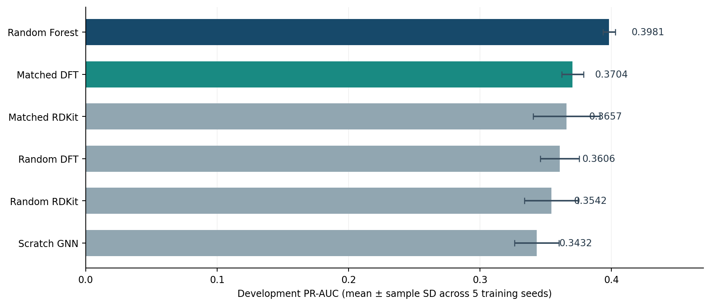
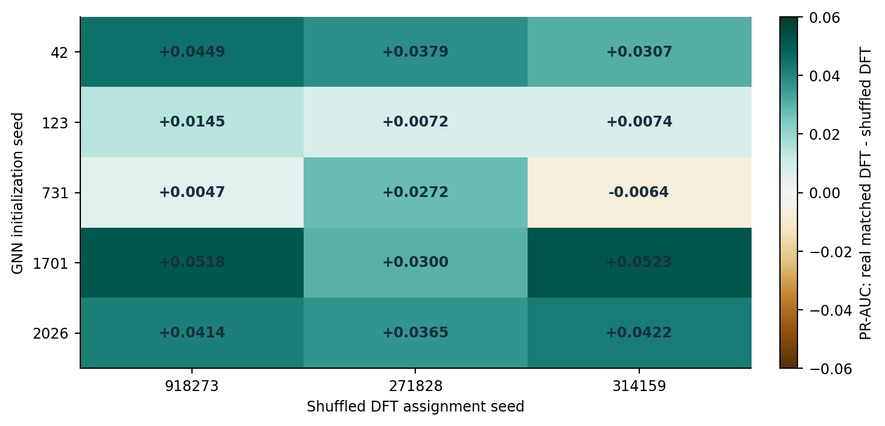

# QuantumBridge-Tox: Domain-aware quantum pretraining for AhR bioactivity prediction

**Status:** Exploratory, reproducible pilot study - **NOT externally validated**  
**As of:** 29 October 2026  
**Primary target:** Tox21 NR-AhR binary classification  
**Primary metric:** PR-AUC (average precision)  
**Implementation:** CPU-only PyTorch molecular message-passing GNN, RDKit and scikit-learn

## Executive summary

We evaluated whether molecular pretraining on quantum-mechanical labels from QM9 or QMugs improves prediction of the Tox21 nuclear receptor aryl hydrocarbon receptor (NR-AhR) endpoint. Preliminary data audits revealed pronounced chemical-domain mismatch: among 7,706 unique Tox21 compounds, only 788 (10.23%) were within the simple QM9-like domain of at most nine heavy atoms drawn from C/H/N/O/F. This is a *necessary-conditions* domain check, not full structural coverage. QMugs provides larger, more drug-like molecules, and 32,023 unique molecules were retained after a deterministic sampling and cleaning procedure.

Using a **fixed scaffold-partitioned development evaluation** of 942 compounds, five independent training seeds (42, 123, 2026, 731, 1701), 5,000 QMugs pretraining compounds per condition, eight pretraining epochs and up to 12 fine-tuning epochs, the matched-QMugs DFT GNN obtained **PR-AUC 0.3704 +/- 0.0083 (sample SD across training seeds)**. This exceeded the scratch GNN (**0.3432 +/- 0.0169**) by a paired mean of **+0.0272** in all five seeds. However, the matched-QMugs RDKit descriptor control (**0.3657 +/- 0.0254**) was close to matched DFT: paired difference **+0.0047**, positive in just 3/5 seeds. The Random Forest baseline remained superior in PR-AUC (**0.3981 +/- 0.0047**).

Shuffling the three genuine QMugs DFT targets as a *joint target vector* broke molecular-label correspondence while preserving marginal and cross-target distributions. Across **three independent shuffle maps** and the same five model-training seeds (15 correlated contrasts), genuine matched DFT beat shuffled DFT in **14/15** comparisons; the per-training-seed means were positive for all five seeds, averaging **+0.0282 PR-AUC**. These findings support the importance of meaningful structure-linked pretraining supervision over a shuffled-label control **within this fixed development partition**. They **do not establish that DFT is uniquely better than RDKit descriptors**, nor do they demonstrate external transfer.

## Data and identity controls

| Material | Provenance / role | Audit findings |
|---|---|---|
| Tox21 | NR-AhR binary classification | 6,440 unique usable labeled compounds; 763 positives, three conflicting keys removed |
| Frozen prior v0.3 Tox21 test | Historical holdout | 1,219 structures; excluded from v0.8-v0.9 fit, matching and evaluation; **not globally untouched because previously viewed in v0.3** |
| Fixed development fold | Primary v0.8-v0.9 evaluation | Train 3,609; early-stopping validation 670; dev evaluation 942, including 115 positive compounds; scaffold-disjoint folds |
| QM9 | Small-molecule DFT precursor | At most nine heavy atoms, elements C/H/N/O/F; not representative of most Tox21 structures |
| QMugs Summary | Larger molecule DFT precursor | 1,992,984 conformer rows scanned; 32,023 unique, eligible compounds retained in 5% deterministic sample; no missing mu/HOMO/LUMO |

QMugs pretraining labels used **DFT_DIPOLE_TOT (mu), DFT_HOMO_ENERGY, DFT_LUMO_ENERGY**. The summary's polarizability column is **GFN2** rather than DFT, and was excluded from the DFT comparison. Each retained QMugs molecule uses the available `conf_00` conformer (not necessarily a global energy minimum). Molecular graphs are 2D while DFT labels can be conformer-dependent.

### Domain audit (sample medians)

| Descriptor | QM9 (5,000 sample) | Tox21 (7,706 unique) | QMugs source pool (32,023 unique) |
|---|---:|---:|---:|
| Heavy atoms | 9 | 16 | 30 |
| Molecular weight | 125.13 | 237.94 | 417.55 |
| LogP | 0.28 | 2.37 | 3.77 |
| Aromatic rings | 0 | 1 | 3 |

The matched QMugs subset (five-run audit; 5,000 pretraining molecules fixed by selection seed) had **23-24 median heavy atoms**, **318-327 median molecular weight**, and **3.14-3.26 median LogP** in earlier v0.6 experiments, compared with about 29-30, 416-420, and 3.78 for random QMugs. This supports improved matching on those descriptors, not necessarily closer coverage across all chemical dimensions. The matched subset was *less* similar to Tox21 on the fraction containing heavy halogens.

## Fixed-partition comparison: v0.8

| Model | PR-AUC mean | SD | ROC-AUC mean | F1 mean | MCC mean |
|---|---:|---:|---:|---:|---:|
| Random Forest (Morgan fingerprint) | **0.3981** | 0.0047 | **0.8358** | **0.4246** | **0.3402** |
| QMugs matched DFT | 0.3704 | 0.0083 | 0.8265 | 0.4035 | 0.3235 |
| QMugs matched RDKit | 0.3657 | 0.0254 | 0.8266 | 0.3683 | 0.2940 |
| QMugs random DFT | 0.3606 | 0.0148 | 0.8215 | 0.3824 | 0.3041 |
| QMugs random RDKit | 0.3542 | 0.0204 | 0.8218 | 0.3649 | 0.2888 |
| Scratch GNN | 0.3432 | 0.0169 | 0.8044 | 0.3309 | 0.2574 |

Five run seeds share **the same** Tox21 scaffold split (split seed 42), QMugs selected identities (selection seed 42), and evaluation molecules. PR-AUC is the primary endpoint. F1 and MCC thresholds were chosen only on inner toxicity validation; no thresholds were optimized on development evaluation. Sample SDs reflect variation from initialization/training **conditional on one dataset partition**, not independent-test uncertainty.

### Paired development PR-AUC effects (five training seeds)

| Contrast | Paired mean | Paired SD | Positive seeds |
|---|---:|---:|---:|
| Matched DFT - Scratch | **+0.0272** | 0.0143 | 5/5 |
| Matched DFT - Random DFT | +0.0098 | 0.0131 | 4/5 |
| Matched DFT - Matched RDKit | **+0.0047** | 0.0330 | 3/5 |
| Matched DFT - Random Forest | **-0.0277** | 0.0085 | 0/5 |

The DFT-vs-RDKit comparison is inconclusive. Using the exact same pretraining molecules controls for chemical selection, but target count, label noise, task difficulty and optimization differ.

## Negative control: v0.9

Three distinct shuffled-target assignments (shuffle seeds 918273, 271828, 314159) were tested, each over the five v0.8 initialization seeds. Per-shuffle mean paired improvements of real matched DFT over shuffled matched DFT:

| Shuffle seed | Mean delta PR-AUC | Model seeds with positive improvement |
|---|---:|---:|
| 918273 | +0.0315 | 5/5 |
| 271828 | +0.0278 | 5/5 |
| 314159 | +0.0253 | 4/5 |
| **Three-map average** | **+0.0282** | **14/15 correlated contrasts** |

Per-model-training-seed means after averaging three shuffle mappings:

| Training seed | Mean paired delta PR-AUC | Minimum | Maximum |
|---|---:|---:|---:|
| 42 | +0.0378 | +0.0307 | +0.0449 |
| 123 | +0.0097 | +0.0072 | +0.0145 |
| 731 | +0.0085 | -0.0064 | +0.0272 |
| 1701 | +0.0447 | +0.0300 | +0.0523 |
| 2026 | +0.0401 | +0.0365 | +0.0422 |

The 15 contrasts are **not** 15 independent replications. All share the same development evaluation fold, the same genuine DFT models per training seed, and just three shuffled assignments. A descriptive seed-level t interval based on five mean deltas is approximately **[+0.006, +0.050]**; it is exploratory, excludes model-selection uncertainty and does not constitute confirmatory evidence. Negative-control pretraining against actual QMugs DFT labels produced mean R2 approximately **-0.0096 (HOMO), -0.1081 (LUMO), -0.0746 (dipole)** on the first shuffle, consistent with broken graph-label correspondence.

## Statistical and scientific limitations

1. **Not independent external validation:** All reported v0.8-v0.9 PR-AUC scores use the same 942-compound development fold. New training seeds are not new held-out chemical cohorts.
2. **Historical test exposure:** The original frozen v0.3 1,219-compound test was inspected earlier in the project; it should not be claimed as globally blind for the entire research program.
3. **Model-selection dependence:** Hypotheses, data sources and controls were refined after viewing prior development results; inferential intervals are exploratory.
4. **Endpoint limitations:** Tox21 NR-AhR is a *specific assay classification*, not a general or clinical toxicity endpoint. It is not evidence of direct human toxicity or cancer-risk prediction.
5. **Assay harmonization:** An external AhR binding/antagonism assay is not interchangeable with the Tox21 NR-AhR agonist-like readout; species, technology and activity direction must be curated.
6. **Data leakage risk:** ToxCast aggregates Tox21-associated data; an EPA source is not automatically independent. External candidate compounds must be excluded by molecular identity against *all* Tox21 and the pretrained QMugs pool, then audited for scaffold overlap and provenance.
7. **Architecture and label mismatch:** A small 2D-GNN, 5k pretraining molecules and 8 pretraining epochs may not exploit the full quantum information. Quantum labels reflect a specific method, conformer and underlying QMugs distribution.
8. **Baselines:** Random Forest remains best on the prespecified PR-AUC; claims of outperforming standard molecular ML are unwarranted.

## Recommendation and status

**Research position:** A reproducible, controlled pilot supporting useful structure-conditioned pretraining and domain-aware compound selection. **No demonstrated quantum-specific superiority over conventional RDKit pretraining; no external validation yet.**

**Next action:** Curate one independent, experimentally measured human AhR *agonist-like* cohort, freeze the external dataset and inclusion rules before scoring, remove all Tox21 identity overlap, document label assay provenance, then score existing fixed v0.8 checkpoints without retraining or selecting hyperparameters based on external performance. A Random Forest should be reconstructed from the documented training recipe and verified against stored development predictions before use on the external set. If sufficient chemical-disjoint labels cannot be obtained, explicitly report external validation as infeasible rather than relabeling an unsuitable endpoint.

## Reproducibility inputs on the user's Linux machine

- `results/gnn_v08_fixed_split_5k/manifest.json`, `fixed_dev_split.csv`, `pretraining_selection.csv`, `development_results.csv`, `paired_controls.csv`, `predictions_seed*.csv`, `checkpoints/`.
- `results/gnn_v09_shuffled_fixed_split_5k/`, `results/gnn_v09_shuffle_271828/`, `results/gnn_v09_shuffle_314159/`.
- Source files `gnn_quantumbridge.py`, `gnn_quantumbridge_v05.py`, `gnn_quantumbridge_v07.py`, `gnn_quantumbridge_v08.py`, `gnn_quantumbridge_v09.py` and original data/split artifacts.
- Companion scripts in this bundle recreate comparison tables and perform a *preliminary external-cohort audit and checkpoint-based evaluation*. They **do not manufacture a dataset or claim an external score**.

## External source starting points (candidate discovery, not yet validated)

- U.S. EPA, [ToxCast invitrodb v4.3 downloads](https://www.epa.gov/comptox-tools/exploring-toxcast-data) (August 2025); [official release package](https://clowder.edap-cluster.com/spaces/687e388ce4b02565bc3e28e4). **ToxCast includes Tox21 program data; verify origin and overlap.**
- [ChEMBL official data web services](https://chembl.gitbook.io/chembl-interface-documentation/web-services/chembl-data-web-services): human AHR target CHEMBL3201 / UniProt P35869. Independently inspect assay methods and source documents before binary-label curation.

**Source transparency:** Numerical results in this report are transcribed from the user's provided terminal summaries; original run CSVs and checkpoints remain on the user's laptop and were *not* present in the report-authoring environment. No outside cohort has been scored in this report.
